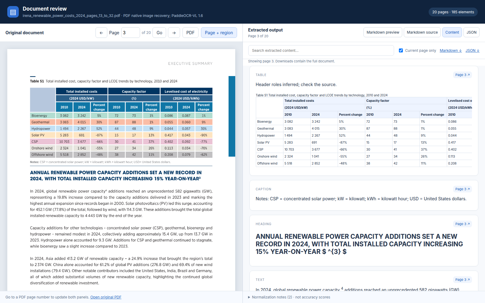
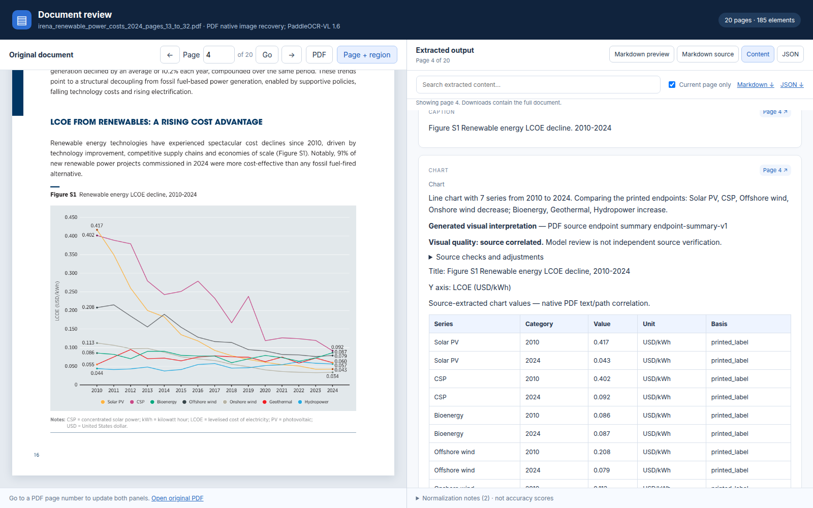
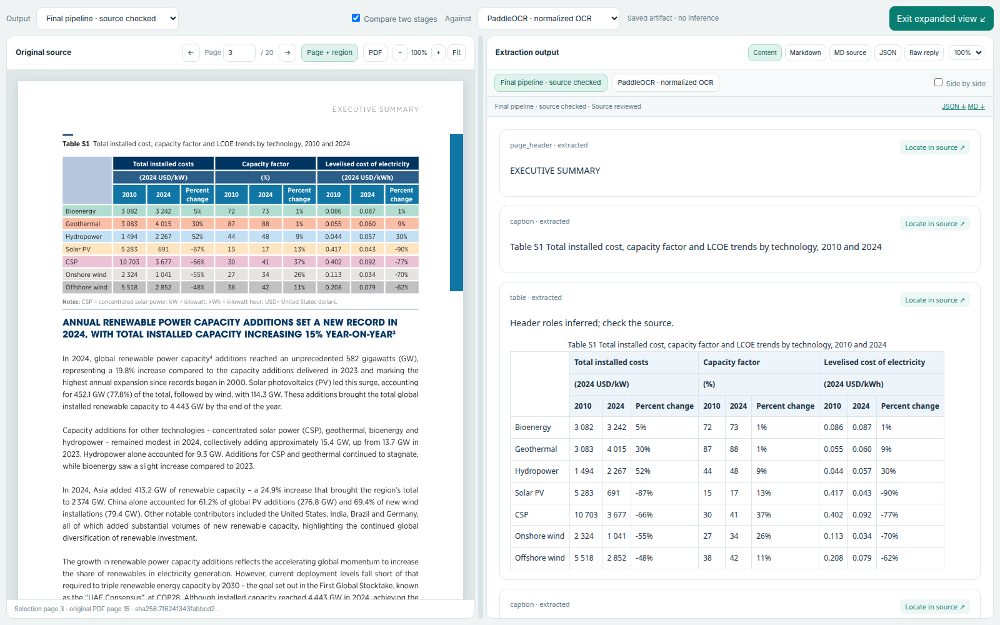

# Multimodal Document Parser

[](https://github.com/bmaged23/multimodal-document-parser/actions/workflows/continuous-integration.yml)
[](https://hub.docker.com/r/bmaged23/multimodal-document-parser)

Evaluate multimodal PDF parsing models and inspect the evidence: source pages,
extracted tables, chart values, structured output, failures and runtime.

**Primary focus:** parser-model comparison and the final parsing pipeline.
Chunking, retrieval and the RAG agent are secondary downstream studies.

[Parsing/model evaluation](docs/parsing-evaluation/README.md) ·
[Parsing pipeline](docs/parsing-pipeline/README.md) ·
[Chunking and RAG](docs/chunking-and-rag/README.md) ·
[All documentation](docs/README.md)

## See the parsing output



Actual review of an IRENA table: source at left, extracted content at right,
with page navigation, source regions, Markdown and JSON views.

<details>
<summary><strong>Chart example: source plot → description, values, units and provenance</strong></summary>



The review distinguishes generated interpretation from values corrected using
native PDF evidence. These are final-pipeline examples, not raw-model accuracy.
Source: IRENA, *Renewable Power Generation Costs in 2024*, original PDF pages
15–16. [Capture provenance](docs/assets/showcase-provenance.json).

</details>



The saved-results explorer adds an expanded reading view, a draggable PDF/output
divider, independent zoom, model/stage comparison tabs, synchronized page search,
and Markdown source/preview, JSON and raw replies.
[Build and launch the explorer](docs/development/evaluation-showcase.md).

## Measured parser comparison

Saved laptop-GPU runs compare **PaddleOCR-VL-1.6** with **dots.mocr Q4_K_M +
Q8_0 projector** on matching document selections.

**dots.mocr demo quantization:** the language model uses **Q4_K_M (4-bit)**
and the vision projector uses **Q8_0 (8-bit)**. These saved results come from that
quantized GPU configuration; quantization precision is distinct from model
parameter count. They do not represent unquantized dots.mocr performance. Full precision may
improve output quality, but its effect and any change in ranking are unmeasured;
we have no matched full-precision GPU comparison.

| Observed case | PaddleOCR-VL-1.6 | Quantized dots.mocr |
| --- | ---: | ---: |
| NASA financial report, selected 20 pages | 20 accepted | 20 accepted |
| Median measured page time on that NASA selection | 155.7 s | 25.9 s |
| Handwritten diary, selected 5 pages | 5 saved | 3 accepted; 2 token-limit failures |
| Selected cell assertions on one small sensor table | 20/20 | 20/20 |

Accepted pages are not necessarily accurate pages. Backend timing scopes,
initialization and inference image dimensions differ, so these timings are an
operational profile, not a controlled speedup or a model-quality ranking.
The NASA selection has no independent accuracy reference.

[Measured comparison data](evaluation/results/parser-comparison-showcase-v1.json) ·
[GPU batch findings](docs/evaluation/quantized-gpu-batch.md) ·
[Configuration and limits](docs/evaluation/dots-mocr-local-validation.md)

## Evaluate the final pipeline separately

The IRENA/IMF development evaluation covers **46 selected pages**. It tests
extraction, normalization and visual enrichment against selected source assertions.

| Selected source check | Initial baseline | Source-reviewed final pipeline |
| --- | ---: | ---: |
| Table-cell text | 277/277 | 277/277 |
| Merged-cell span attributes | 40/40 | 40/40 |
| Sampled column-header roles | 0/32 | 32/32, marked inferred |
| Printed chart values matched to series/category | 141/144 | 144/144, after PDF source correction |

These are selected assistant-reviewed development checks, not full-document
accuracy or independent human annotations. Repaired pipeline scores must not be
attributed to the raw OCR or VLM model.

[Initial findings and failures](docs/evaluation/irena-imf-source-review.md) ·
[Repairs and final checks](docs/evaluation/final-source-quality-repair.md) ·
[Raw VLM comparison limits](docs/evaluation/five-model-vlm-benchmark.md)

## Deployment and CI/CD

The GPU parsing image includes PDF/DOCX preparation, PaddleOCR, normalized exports,
HTML review and the Ollama Cloud client for Gemma visual descriptions. Gemma runs
in the cloud; its weights and runtime credentials are not baked into the image.
OCR weights use a persistent cache populated on first use. The comparison's
quantized dots.mocr server is a separate runtime.

[Container contents, deployment and public Docker Hub release](docs/deployment/docker-hub.md) ·
[Parsing-only Compose](compose.parsing.yaml) ·
[CI checks](.github/workflows/continuous-integration.yml) ·
[Docker build checks](.github/workflows/container-build.yml) ·
[Docker Hub release workflow](.github/workflows/docker-hub-release.yml)

The public release candidate is available on [Docker Hub](https://hub.docker.com/r/bmaged23/multimodal-document-parser):

```bash
docker pull bmaged23/multimodal-document-parser:0.1.0-rc.1
```

Anonymous registry access and the tested image digest were verified, including
SBOM and build provenance. Local checks passed API/auth, DOCX conversion, page
rendering and a CUDA tensor. The release workflow gates future publication on CI
and image checks. GitHub Actions runs on source pushes and pull requests. Automated
Docker releases still need the environment token; no hosted demo is claimed. See the
[deployment evidence](docs/deployment/docker-hub.md#local-validation-status-2026-11-02).

## Secondary comparison: chunking and RAG

After evaluating parsing, we tested how its saved output supports retrieval and
answers. The study uses **100 questions across five approaches**: 200 new
structural-baseline cases and 300 reused advanced cases.

| Approach | Strict judge passes /100 | Citation-support mean | Answer-model calls/question |
| --- | ---: | ---: | ---: |
| Simple structural chunks + dense | 88 | 0.985 | 1 |
| Simple structural chunks + hybrid | 85 | 0.983 | 1 |
| Adaptive chunks + hybrid, one pass | 94 | 0.968 | 1 |
| Adaptive + parent expansion, one pass | 94 | 0.663 | 1 |
| Adaptive + parent expansion + agent | 93 | 0.667 | 1.9 |

The simple baseline repeats headings and table headers, separates tables/visuals,
links related explanations, and splits at semantic boundaries. Fixed-size chunks
are retained as diagnostic experiments, not the main simple baseline.

**Assessment:** adaptive hybrid with one-pass answering is the current candidate;
the full agent did not demonstrate an overall improvement. These are automated
rubric results, not independently verified accuracy. Citation means exclude
unavailable cases and have different denominators. A source review found remaining
judge errors despite passing synthetic controls, so small ranking differences
are inconclusive. These scores do not measure parsing accuracy.

[Detailed chunking/RAG README](docs/chunking-and-rag/README.md) ·
[Saved comparison and assessment](docs/evaluation/simple-structural-versus-adaptive-rag.md) ·
[Measured results](evaluation/results/rag-structural-comparison-v2.json) ·
[Judge and source audit](docs/evaluation/judge-validation-and-rag-ablation.md)

## Detailed guides

| Read more | What it covers |
| --- | --- |
| [Parsing evaluation](docs/parsing-evaluation/README.md) | Model configurations, datasets, metrics, measured comparisons, failure cases and reproduction |
| [Parsing pipeline](docs/parsing-pipeline/README.md) | Preparation, OCR, canonical JSON, visual enrichment, source review, exports, APIs and deployment status |
| [Chunking and RAG](docs/chunking-and-rag/README.md) | Chunking variants, GPU embeddings, retrieval, agent flow, completed evaluation and judge limitations |

**Implementation status:** parsing, visual enrichment, review exports and local
service APIs are implemented within their documented scopes. Docker definitions
and CI are configured; container deployment, a hosted demo and an independent
benchmark remain unverified.

## Quick start

Requirements: uv 0.12.24. uv provisions Python 3.12 using `.python-version`.

```bash
uv sync --locked
uv run document-parser-check-environment
```

The project environment lives in `.venv/`. Optional shell activation:

```bash
source .venv/bin/activate
```

## Prepare a PDF

```bash
uv run document-parser prepare data/input_documents/example.pdf
uv run document-parser prepare data/input_documents/example.pdf --dpi 200
uv run document-parser schema
```

The command prints the bundle directory containing `document.json`, a source PDF
snapshot, and rendered PNG pages. Preparation does not perform OCR. The document
has `status=prepared` and an empty elements array until a parser runs. Existing
bundles are never overwritten. Use `--output-directory` for a fresh destination.
See the [schema reference](docs/reference/document-schema.md) for coordinates,
identity, content types, limits, and a synthetic JSON example.

## Parse and review

```bash
uv sync --project backends/paddleocr_runtime --locked
uv run document-parser parse outputs/parsed_documents/<document-hash>-dpi-144
```

The command prints the HTML review path. Open it with the accompanying assets,
or serve its run directory locally. The original PDF appears on the left and
extracted content on the right, with Markdown/JSON tabs and source-box inspection.
See [parsing and review instructions](docs/development/paddleocr-parsing-and-html-review.md)
for runtime requirements, commands, limitations, and browser checks.

## Compare parsers

The dots.mocr adapter supports saved-result import and an OpenAI-compatible server,
with explicit model revision/quantization, bounded requests, and preserved responses.
See [runtime setup](backends/dots_mocr_runtime/README.md) and the
[comparison guide](docs/evaluation/parser-comparison.md). The quantized configuration ran on the laptop GPU; see
[local findings and limitations](docs/evaluation/dots-mocr-local-validation.md).

```bash
uv run document-parser compare outputs/parser_runs/paddleocr-run \
  outputs/parser_runs/dots-mocr-run \
  --output-directory outputs/parser_comparisons/example
```

## Evaluation documents

Four public-source PDFs (410 pages) are available through the reproducible
[corpus manifest](evaluation/corpus-manifest.json): long financial/scientific
reports, illustrated spreads, and a real handwritten diary. See the
[case matrix and evaluation plan](docs/evaluation/evaluation-corpus.md).

```bash
uv run python scripts/download_evaluation_documents.py
```

The original PDFs stay local and ignored by Git. Downloading the corpus does
not run inference or produce benchmark accuracy scores.

Additional IRENA and IMF selections are pinned in `evaluation/test_cases/`.
Their [evaluation report](docs/evaluation/irena-imf-source-review.md) explains
annotation scope, reproducible scoring, runtime, recovery and failure examples.
Source-reviewed references live in `evaluation/reference_annotations/`; these
single-assistant development annotations are not independent human ground truth.

## Repository layout

```text
.github/workflows/                 GitHub Actions checks
src/multimodal_doc_parser/          Installable Python package
  environment_check.py             Environment smoke-check command
  command_line.py                  Preparation and schema commands
  document_schema/document.py      Validated canonical models
  pdf_preparation/prepare_document.py
                                   PDF rendering and asset bundles
  parser_adapters/                 Backend normalization and run orchestration
  evaluation/                      Run summaries, comparisons and source-review scoring
  document_exports/                Markdown and safe HTML rendering
  review_interface/                Offline HTML review template and report builder
  rag_preparation/                 Parent/child contracts, chunks, GPU embeddings and retrieval
  pipeline_services/               Independent APIs, durable jobs and bounded RAG agent
services/                         Descriptive service folders and OpenAPI contracts
Dockerfile / compose.yaml         Separate API, conversion, OCR and embedding images/workers
backends/paddleocr_runtime/         Isolated, locked PaddleOCR GPU environment
backends/dots_mocr_runtime/         Pinned dots.mocr model/runtime artifacts and setup
evaluation/corpus-manifest.json    Public document sources, hashes, and page selections
evaluation/reference_annotations/ Source-bound development checks
evaluation/results/               Measured summaries with scope and input hashes
schemas/document-v1.schema.json    Exported JSON Schema
tests/unit/                        Schema constraints
tests/integration/                 PDF preparation, parsing exports, and CLI checks
tests/browser/                     Interactive HTML review checks
tests/fixtures/paddleocr/           Labeled synthetic backend results
docs/
  README.md                        Documentation map and reading order
  parsing-evaluation/README.md      Models, benchmarks, comparisons and limits
  parsing-pipeline/README.md        Primary document-processing pipeline
  chunking-and-rag/README.md        Secondary downstream pipeline and study
  project/milestones.md             Deliverables and milestone progress
  development/hardware-report.md    Observed laptop resources and limitations
  architecture/document-processing-design.md
                                   Planned processing boundaries
data/input_documents/              Local input PDFs (Git ignored)
outputs/parsed_documents/          Prepared PDF bundles (Git ignored)
outputs/parser_runs/               Parsed outputs and reports (Git ignored)
pyproject.toml                     Dependencies, entry point, quality settings
uv.lock                            Resolved dependency versions
```

Add descriptive implementation modules as functionality is built. Keep private
PDFs, credentials, model weights, and generated results out of Git.

## Development checks

```bash
uv run ruff format --check .
uv run ruff check .
uv run mypy
uv run pytest
uv run document-parser-check-environment
uv build
```

GitHub Actions runs these checks on pushes and pull requests. Tests cover schema
invariants, generated PDFs, rotation, input limits,
cleanup on failure, and the installed CLI. GPU evaluations are preserved separately from these automated checks; CI tests
do not establish OCR quality or prove deployment.

## Visual enrichment: Gemma 4 31B on Ollama Cloud

**Gemma 4 31B** (`gemma4:31b`) is the current visual-enrichment default, accessed
through Ollama Cloud. It is a 31B-class multimodal model; no local model download
or GPU inference is required for this stage. OCR continues using the chosen local
parser. See the [official model listing](https://ollama.com/library/gemma4).

Set `OLLAMA_API_KEY` in your environment or the ignored project `.env` (see
`.env.example`), then enrich a parsed run into a fresh directory:

```bash
uv run document-parser enrich outputs/parser_runs/paddleocr-vl-1.6-reviewed \
  --output-directory outputs/parser_runs/my-enriched-run
```

The model receives each visual crop and a marked page-context image. Generated
descriptions, chart values/units, flowchart connections and uncertainty remain
separate from OCR provenance. Exact inputs/hashes, effective prompts, native
responses and the returned model alias are preserved; hosted deployment weights
are not claimed to be immutable. Cloud requests send these document images to
Ollama's service. Credentials never appear in reports, manifests or Git.

On the original two-page development sample, all three visuals completed and
**9/9 selected source-derived checks passed** (three visual types, three printed
chart values with units, and three flowchart connections). Manual review also
confirmed the synthetic image description and 50 um scale bar. This small test
is not a general accuracy benchmark or independent human annotation.

Ollama Cloud does not currently enforce JSON schemas: the schema is supplied in
the prompt and output is validated locally. One complete JSON Markdown fence may
be unwrapped while retaining the original native response; malformed/truncated
JSON and semantic violations are preserved as failures, never repaired silently.
Older local Qwen experiments and their failures remain archived separately.

See [Gemma validation](docs/evaluation/gemma4-cloud-visual-validation.md),
[setup and reproduction](docs/development/ollama-visual-enrichment.md), and
[earlier cloud model research](docs/evaluation/cloud-model-selection-history.md).

## Local service APIs (secondary setup)

The [service architecture](docs/architecture/service-pipeline.md) separates
ingestion from agentic questions. Seven stage APIs have checked-in OpenAPI
contracts under `services/`. Long processing runs in separate durable workers.

```bash
uv sync --locked --extra api --extra chunking --extra rag
uv run --extra api --extra rag python scripts/configure_service_secrets.py
uv run --extra api --extra rag python scripts/run_development_services.py
```

- Document pipeline API: `http://127.0.0.1:8100/docs`
- Agentic RAG API: `http://127.0.0.1:8106/docs`

Authorize using the private local `PIPELINE_API_KEY`. The RAG API exposes no
upload or ingestion routes. Embeddings use **BAAI/bge-large-en-v1.5**, **1,024
dimensions**, with verified CUDA execution. Gemma 4 31B remains on Ollama Cloud.
See the [development validation](docs/evaluation/adaptive-rag-development.md) for
chunk coverage, retrieval checks, one real cited answer and current limitations.
Compose and Docker image definitions are provided; they have not been run here
because Docker Desktop WSL integration is unavailable.

See the [initial local validation](docs/evaluation/paddleocr-local-validation.md)
for measurements, manual checks, and observed parsing limitations.

## Intended capabilities

- Compare PaddleOCR-VL-1.6 and dots.mocr through a shared schema.
- Preserve text, headings, tables, formulas, source coordinates, and reading order.
- Enrich charts and images with grounded descriptions and structured values.
- Export canonical JSON, readable Markdown, source crops, and JSONL chunks.
- Publish reproducible evaluation results and a deployed review demo.

See the [milestones](docs/project/milestones.md),
[architecture](docs/architecture/document-processing-design.md), and
[hardware findings](docs/development/hardware-report.md).
