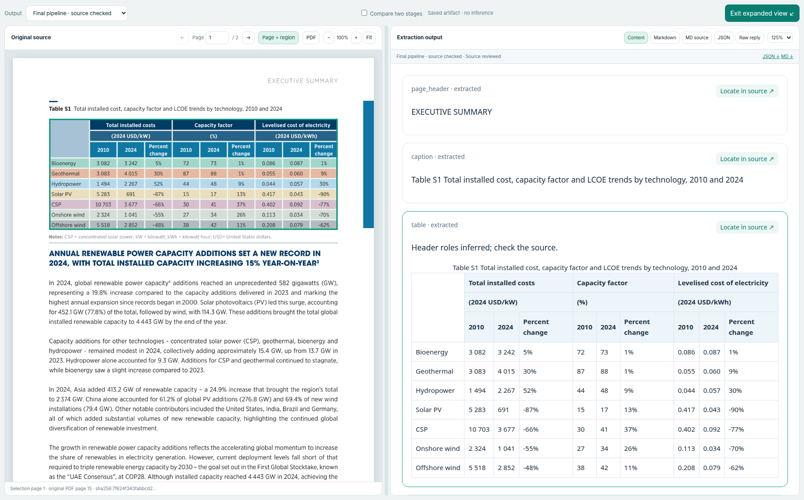
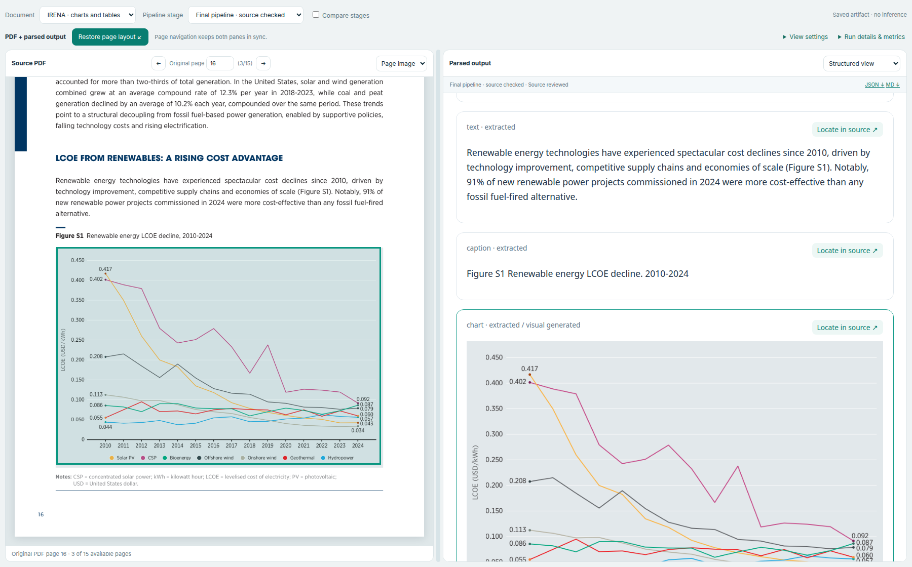
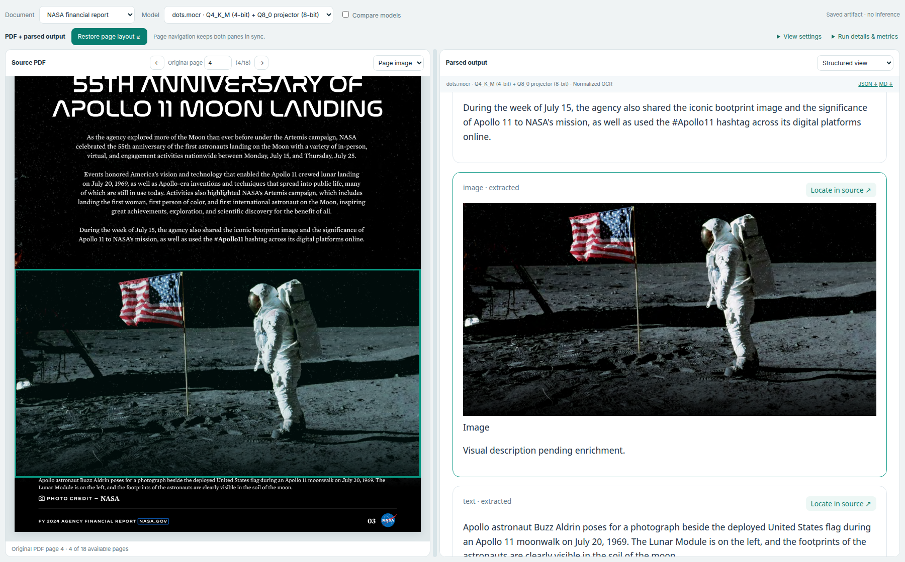
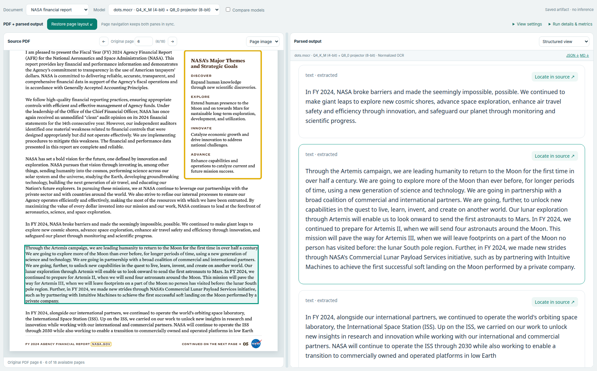
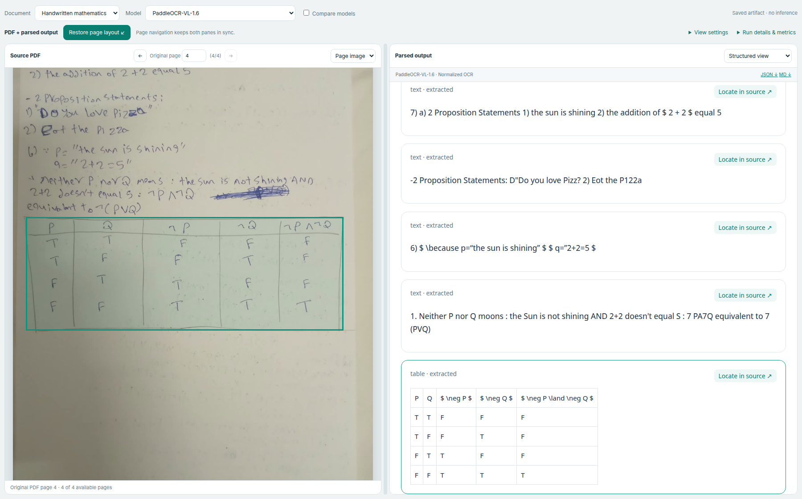
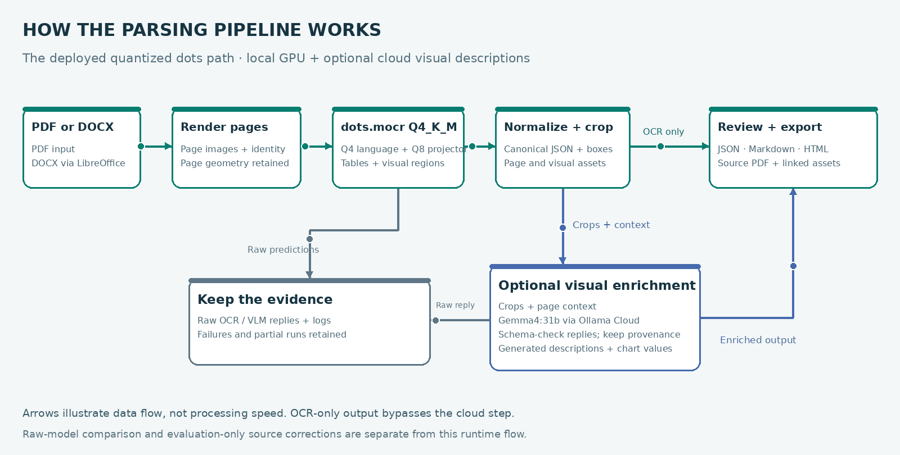

# Multimodal Document Parser

**Parser choice:** quantized dots.mocr (Q4_K_M + Q8_0) is the production default. Original BF16 dots achieved our best selected handwritten-mathematics result (32/37), with **8.53 GiB peak PyTorch-allocated GPU memory** on a Colab T4. [Results, memory scope and limits](docs/evaluation/parser-model-selection.md).

[](https://github.com/bmaged23/multimodal-document-parser/actions/workflows/continuous-integration.yml)
[](https://hub.docker.com/r/bmaged23/multimodal-document-parser)

Compare **dots.mocr Q4/Q8**, **original dots.mocr BF16**, **PaddleOCR-VL-1.6**, and **Unlimited-OCR 2**
on real document selections. Inspect extracted text, tables, charts, images,
failures and runtime beside the original source pages.

**Primary focus:** parser-model comparison and the final parsing pipeline.
Chunking, retrieval and the RAG agent are secondary downstream studies.

## Live demo

[](https://bmaged23.github.io/multimodal-document-parser/?v=4.1)

**Click the banner to try the interactive demo—no setup, GPU or API key needed.**

Browse saved results with the **PDF on the left and extraction on the right**.
Switch between all four profiles, compare OCR/enriched/source-reviewed stages,
and inspect rendered Markdown, Markdown source, JSON, raw replies and source boxes.
The reader now includes **53 saved pages across NASA, IRENA charts, IMF complex
tables and the author’s handwritten mathematics assignment**. Choose a document in the sidebar, switch
its model or pipeline stage, and use **Expand PDF + output** beside the reading
area. Metrics and zoom are optional settings; output formats use one dropdown.
This is a read-only saved-output demo, not a live upload/inference service.

[Download the portable demo](https://github.com/bmaged23/multimodal-document-parser/releases/download/demo-v4.1/public-demo-v4.1.zip) ·
[Local demo instructions](docs/development/evaluation-showcase.md#run-the-downloaded-demo) ·
[Parsing/model evaluation](docs/parsing-evaluation/README.md) ·
[Parsing pipeline](docs/parsing-pipeline/README.md) ·
[All documentation](docs/README.md)

### Five output examples

**Complex table — source cells, merged headers and structured output.**



IRENA, original PDF page 15. This final-pipeline view marks inferred header roles;
it is not a raw-model accuracy score. Expand the examples below to see other content.

<details>
<summary><strong>Chart — source plot, description, values and provenance</strong></summary>



IRENA, original PDF page 16. Generated interpretation is distinct from values
corrected using PDF evidence; final-pipeline checks are separate from raw VLM quality.

</details>

<details>
<summary><strong>Image — extracted photograph and its caption</strong></summary>



NASA financial report, original PDF page 4. Photograph credited to NASA.
This is the saved OCR/image-crop stage; no new visual description was generated
for this NASA example. NASA does not endorse this project.

</details>

<details>
<summary><strong>Text — narrative paragraphs and source coordinates</strong></summary>



NASA financial report, original PDF page 6. The source box connects the selected
paragraph to its saved text extraction; model outputs remain inspectable.

</details>

<details>
<summary><strong>Handwriting — the author’s mathematical assignment and truth table</strong></summary>



The author’s assignment, page 4 of four original photos. Transcription errors
remain visible. [Three-model handwriting evaluation](docs/evaluation/author-handwritten-mathematics.md).
The previous diary outputs remain archived.

</details>

IRENA examples: © IRENA 2025, *Renewable Power Generation Costs in 2024*,
International Renewable Energy Agency, Abu Dhabi. These are real browser captures,
not generated mockups. [Page mappings and screenshot hashes](docs/assets/readme-gallery.provenance.json).

## How the parsing pipeline works



The animation shows the deployed **quantized dots.mocr path**: OCR-only output goes straight
to exports, while optional visual enrichment sends crops and page context to
**Gemma through Ollama Cloud**. Raw responses and failures are retained.
[Static diagram](docs/assets/parsing-pipeline.svg) ·
[Implementation checks and source hashes](docs/assets/pipeline-diagram-verification.json)


1. **Prepare:** convert DOCX to PDF when needed, then render page images and record source identity.
2. **Parse:** extract text, headings, tables and visual regions, retaining raw model responses.
3. **Normalize:** map supported outputs into one JSON schema with reading order, table cells and page coordinates.
4. **Describe visuals:** optionally send chart/image crops to Gemma through Ollama Cloud; retain generated descriptions, numbers, uncertainty and provenance separately from OCR.
5. **Review and export:** compare the source with JSON, Markdown and HTML; keep failures and inferred structure visible. Chunking/RAG is an optional downstream study.

The deployed service defaults to **quantized dots.mocr**. The container worker manages
its CUDA server; PaddleOCR remains an optional native backend; **Unlimited-OCR 2 is an experimental saved-output evaluation path**,
not an integrated production backend. Source-reviewed evaluation repairs are
identified explicitly; they do not guarantee correct extraction for every upload.
[Detailed pipeline README](docs/parsing-pipeline/README.md).

## Measured parser comparison

All three configurations were tested on an **NVIDIA GeForce GTX 1660 Ti with
6 GB VRAM (6,144 MiB)** under WSL2. OCR runs were sequential. Gemma visual
enrichment executes on Ollama Cloud, not on this laptop GPU.

- **PaddleOCR-VL-1.6:** integrated parsing and normalized exports.
- **dots.mocr:** Q4_K_M language weights with a Q8_0 vision projector on GPU.
- **Unlimited-OCR 2:** NF4 language / FP16 vision diagnostic runs with compatibility changes; saved raw generations remain separate from canonical parsing.

**dots.mocr demo quantization:** the language model uses **Q4_K_M (4-bit)**
and the vision projector uses **Q8_0 (8-bit)**. These saved results come from that
quantized GPU configuration; quantization precision is distinct from model
parameter count. The public demo retains this quantized baseline. A separate
original-weight BF16 run on a Colab T4 now covers the same 31 input PNGs:
[unquantized versus retained parser profiles](docs/evaluation/dots-mocr-colab-bf16-comparison.md).
Different hardware, backends and conversion lineage prevent isolating quantization alone.

| Observed case | PaddleOCR-VL-1.6 | Quantized dots.mocr | Unlimited-OCR 2 NF4/FP16 | Original dots BF16 |
| --- | ---: | ---: | ---: | ---: |
| NASA financial report, selected 20 pages | 20 accepted | 20 accepted | 20 completed generations | 20 accepted |
| NASA PDF-text-layer token F1 | 96.59% | 97.13% | 96.17% | 97.14% |
| Median measured NASA page time | 155.7 s | 25.9 s | 108.1 s generation-only | 61.7 s on Colab T4 |
| Historical diary, archived 5-page selection | 5 accepted | 3 accepted; 2 token-limit failures | 3 completed; 2 timeouts | 4 accepted; 1 time limit |
| Selected small sensor-table cell checks | 20/20 | 20/20 | 20/20 | 20/20 raw; 0/2 original pages normalize |
| Peak memory across retained runs | 5,959 MiB device | 5,914 MiB device | 3,150 MiB allocator | **8,739 MiB / 8.53 GiB allocator** |

Device peaks are sampled total GPU memory; allocator peaks are PyTorch maxima.
They are different metrics, not minimum GPU capacities. BF16 ran on Colab T4;
the other profiles ran on GTX 1660 Ti (6 GB). Printed token F1 is source-text
recovery, not overall document accuracy or diagram understanding.

Accepted or generated pages are not necessarily accurate pages. Backend timing
scopes, initialization, precision, preprocessing and image dimensions differ;
Unlimited-OCR 2 additionally reloads the model per page, excluded from the median
above. These are operational observations, not a controlled speedup or quality
ranking. NASA's selection has no independent accuracy reference. The cell checks
cover only one small development table, not a general table benchmark.

[Four-profile comparison and per-page data](evaluation/results/parser-corpus-four-profiles-v1.json) ·
[Paddle/dots batch findings](docs/evaluation/quantized-gpu-batch.md) ·
[Unlimited-OCR 2 findings](docs/evaluation/unlimited-ocr-2-gpu-results.md) ·
[Hardware and limits](docs/development/hardware-report.md)

### Author-written mathematics · four photos

**Finding: original BF16 dots.mocr achieved our best selected handwritten
mathematics result: 32/37 checks**, versus quantized dots 29/37, PaddleOCR 13/37
and Unlimited-OCR 11/37. Quantized dots is the production default for the 6 GB
laptop; BF16 peaked at 8.53 GiB PyTorch allocation on Colab T4. Formula review
remains necessary, and BF16 does not win every category.

The current handwriting demo uses the author’s own assignment. These are selected
assistant-reviewed presence checks, not independent annotations or full-page accuracy.
Ambiguous/crossed-out spans are excluded; original mathematical mistakes stay unchanged.

| Tested profile | Text spans /18 | Math expressions /19 | Ordered truth-table cells /20 |
| --- | ---: | ---: | ---: |
| PaddleOCR-VL-1.6 | 8/18 | 5/19 | 20/20 |
| dots.mocr Q4_K_M + Q8_0 | 17/18 | 12/19 | 20/20 |
| Unlimited-OCR 2 NF4/FP16 | 9/18 | 2/19 | 20/20 |
| Original dots.mocr BF16 · Colab T4 | **17/18** | **15/19** | 20/20 |

PaddleOCR and both dots profiles completed 4/4 pages; Unlimited completed 2/4 and timed out on
pages 1 and 3. Missing outputs count as unrecovered checks. dots recovered the
most selected text/math on this case; Unlimited preserved more Venn-diagram
regions on page 2. Time budgets, precision and internal preprocessing differ.
[Method, timings and failures](docs/evaluation/author-handwritten-mathematics.md) ·
[Every saved check](evaluation/results/author-handwritten-mathematics-comparison-v1.json).

### Original dots.mocr BF16 · Colab follow-up

Re-scoring all four profiles with the unchanged handwriting reference gives
**32/37** selected checks for original BF16 dots.mocr, **29/37** for quantized
dots.mocr, **13/37** for PaddleOCR and **11/37** for Unlimited-OCR. All score
20/20 ordered truth-table cells. BF16 improves selected mathematics recovery
(15/19 versus 12/19); prose ties (17/18).

Across the 31 matched pages, BF16 finished 30 generations and passed the strict
canonical schema on 28; quantized dots passed on 29. Better selected handwriting
does not imply better output validity everywhere. NASA has completion/timing
measurements, without a full-page accuracy reference.
[Four-profile method and limitations](docs/evaluation/dots-mocr-colab-bf16-comparison.md) ·
[Per-check metrics](evaluation/results/author-handwritten-mathematics-four-profiles-v1.json).

The [complete four-profile, 31-page comparison](docs/evaluation/parser-corpus-four-profiles.md)
covers NASA, the original multimodal sample, the historical diary and the author
assignment. It reports printed-text recovery, selected table/visual checks and
failures separately; [metrics and per-page evidence](evaluation/results/parser-corpus-four-profiles-v1.json)
are saved alongside it.

## Evaluate the final pipeline separately

**What does “final pipeline” mean here?** It is the evaluated saved-report
version assembled from **PaddleOCR → normalized document JSON → Gemma visual
descriptions → disclosed source-based postprocessing and review → exports**.
The earlier baseline is a previous snapshot of this assembled pipeline, not a
separate raw-model accuracy score.

The reviewed version links table structure and captions, explicitly marks inferred
headers, and corrects selected chart values using native PDF text/vector evidence.
Those evaluation-specific repairs are documented; they do not mean every new
uploaded PDF is automatically corrected or independently verified.

We checked **46 selected pages: 20 IRENA pages and 26 IMF appendix pages** against
specific source assertions. In the table, **277/277 means 277 selected cell-text
checks matched**, not 277 tables or perfect accuracy across all document content.

| Selected source check | Earlier pipeline snapshot | Final source-reviewed snapshot |
| --- | ---: | ---: |
| Table-cell text | 277/277 | 277/277 |
| Merged-cell span attributes | 40/40 | 40/40 |
| Sampled column-header roles | 0/32 | 32/32, marked inferred |
| Printed chart values matched to series/category | 141/144 | 144/144, after PDF source correction |

These are selected assistant-reviewed development checks, not full-document
accuracy or independent human annotations. Repaired pipeline scores must not be
attributed to the raw OCR or VLM model.

[Initial findings and failures](docs/evaluation/irena-imf-source-review.md) ·
[Repairs and final checks](docs/evaluation/final-source-quality-repair.md) ·
[Raw VLM comparison limits](docs/evaluation/five-model-vlm-benchmark.md)

## Secondary comparison: chunking and RAG

After evaluating parsing, we tested how its saved output supports retrieval and
answers. The study uses **100 questions across five approaches**: 200 new
structural-baseline cases and 300 reused advanced cases.

| Approach | Strict judge passes /100 | Citation-support mean | Answer-model calls/question |
| --- | ---: | ---: | ---: |
| Simple structural chunks + dense | 88 | 0.985 | 1 |
| Simple structural chunks + hybrid | 85 | 0.983 | 1 |
| Adaptive chunks + hybrid, one pass | 94 | 0.968 | 1 |
| Adaptive + parent expansion, one pass | 94 | 0.663 | 1 |
| Adaptive + parent expansion + agent | 93 | 0.667 | 1.9 |

The simple baseline repeats headings and table headers, separates tables/visuals,
links related explanations, and splits at semantic boundaries. Fixed-size chunks
are retained as diagnostic experiments, not the main simple baseline.

**Assessment:** adaptive hybrid with one-pass answering is the current candidate;
the full agent did not demonstrate an overall improvement. These are automated
rubric results, not independently verified accuracy. Citation means exclude
unavailable cases and have different denominators. A source review found remaining
judge errors despite passing synthetic controls, so small ranking differences
are inconclusive. These scores do not measure parsing accuracy.

[Detailed chunking/RAG README](docs/chunking-and-rag/README.md) ·
[Saved comparison and assessment](docs/evaluation/simple-structural-versus-adaptive-rag.md) ·
[Measured results](evaluation/results/rag-structural-comparison-v2.json) ·
[Judge and source audit](docs/evaluation/judge-validation-and-rag-ablation.md)

## Detailed guides

| Read more | What it covers |
| --- | --- |
| [Parsing evaluation](docs/parsing-evaluation/README.md) | Model configurations, datasets, metrics, measured comparisons, failure cases and reproduction |
| [Parsing pipeline](docs/parsing-pipeline/README.md) | Preparation, OCR, canonical JSON, visual enrichment, source review, exports, APIs and deployment status |
| [Chunking and RAG](docs/chunking-and-rag/README.md) | Chunking variants, GPU embeddings, retrieval, agent flow, completed evaluation and judge limitations |

**Implementation status:** parsing, visual enrichment, review exports and local
service APIs are implemented within their documented scopes. Docker definitions
and CI are active; the public parsing image passed local runtime/GPU checks.
Hosted API/parsing container checks passed. The public demo serves curated saved
outputs; live hosted inference and an independent benchmark remain unverified.

## Clone and install from source

Use Linux or WSL2 for the GPU runtime. The project uses **Python 3.12** and **uv**;
CI pins uv 0.12.24. Install Git and [uv](https://docs.astral.sh/uv/getting-started/installation/)
first. The official Linux/WSL installer is:

```bash
curl -LsSf https://astral.sh/uv/install.sh | sh
```

Open a new terminal so `uv` is on your PATH, then:

```bash
git clone https://github.com/bmaged23/multimodal-document-parser.git
cd multimodal-document-parser
uv python install 3.12
uv sync --locked
uv run --locked document-parser-check-environment
uv run --locked document-parser --help
```

The project environment lives in `.venv/`. Preparation and schema inspection work
without downloading OCR weights. Live PaddleOCR needs the separate runtime shown
below and a compatible NVIDIA GPU/driver. Optional API dependencies and cloud
credentials are covered in the [API guide](docs/api/README.md).

Prefer the packaged runtime? Follow the independent
[Docker clone, pull and startup instructions](docs/docker/README.md#clone-and-run-the-published-image);
that path needs no uv environment or local Paddle installation.

## Prepare a PDF

```bash
uv run document-parser prepare data/input_documents/example.pdf
uv run document-parser prepare data/input_documents/example.pdf --dpi 200
uv run document-parser schema
```

The command prints the bundle directory containing `document.json`, a source PDF
snapshot, and rendered PNG pages. Preparation does not perform OCR. The document
has `status=prepared` and an empty elements array until a parser runs. Existing
bundles are never overwritten. Use `--output-directory` for a fresh destination.
See the [schema reference](docs/reference/document-schema.md) for coordinates,
identity, content types, limits, and a synthetic JSON example.

## Parse and review

```bash
uv run python scripts/model_runtimes/setup_dots_mocr_runtime.py
uv run python scripts/model_runtimes/build_dots_mocr_runtime.py --jobs 4
# In a separate terminal: uv run python scripts/model_runtimes/serve_dots_mocr.py
uv run document-parser parse outputs/parsed_documents/<document-hash>-dpi-144
```

The command prints the HTML review path. Open it with the accompanying assets,
or serve its run directory locally. The original PDF appears on the left and
extracted content on the right, with Markdown/JSON tabs and source-box inspection.
See [parsing and review instructions](docs/development/paddleocr-parsing-and-html-review.md)
for the optional Paddle runtime. The default dots setup is documented in
[the dots runtime README](backends/dots_mocr_runtime/README.md).

## Compare parsers

The dots.mocr adapter supports saved-result import and an OpenAI-compatible server,
with explicit model revision/quantization, bounded requests, and preserved responses.
See [runtime setup](backends/dots_mocr_runtime/README.md) and the
[comparison guide](docs/evaluation/parser-comparison.md). The quantized configuration ran on the laptop GPU; see
[local findings and limitations](docs/evaluation/dots-mocr-local-validation.md).

```bash
uv run document-parser compare outputs/parser_runs/paddleocr-run \
  outputs/parser_runs/dots-mocr-run \
  --output-directory outputs/parser_comparisons/example
```

## Evaluation documents

Four public-source PDFs (410 pages) are available through the reproducible
[corpus manifest](evaluation/corpus-manifest.json): long financial/scientific
reports, illustrated spreads, and an author-written mathematical assignment. See the
[case matrix and evaluation plan](docs/evaluation/evaluation-corpus.md).

```bash
uv run python scripts/document_processing/download_evaluation_documents.py
```

The original PDFs stay local and ignored by Git. Downloading the corpus does
not run inference or produce benchmark accuracy scores.

Additional IRENA and IMF selections are pinned in `evaluation/test_cases/`.
Their [evaluation report](docs/evaluation/irena-imf-source-review.md) explains
annotation scope, reproducible scoring, runtime, recovery and failure examples.
Source-reviewed references live in `evaluation/reference_annotations/`; these
single-assistant development annotations are not independent human ground truth.

## Repository layout

```text
.github/workflows/                 GitHub Actions checks
src/multimodal_doc_parser/          Installable Python package
  environment_check.py             Environment smoke-check command
  command_line.py                  Preparation and schema commands
  document_schema/document.py      Validated canonical models
  pdf_preparation/prepare_document.py
                                   PDF rendering and asset bundles
  parser_adapters/                 Backend normalization and run orchestration
  evaluation/                      Run summaries, comparisons and source-review scoring
  document_exports/                Markdown and safe HTML rendering
  review_interface/                Offline HTML review template and report builder
  rag_preparation/                 Parent/child contracts, chunks, GPU embeddings and retrieval
  pipeline_services/               Independent APIs, durable jobs and bounded RAG agent
services/                         Descriptive service folders and OpenAPI contracts
scripts/                          Task scripts grouped by purpose; see scripts/README.md
Dockerfile / compose.parsing.yaml Primary parsing image and preparation/parsing APIs/workers
compose.yaml                      Optional full secondary RAG stack
backends/paddleocr_runtime/         Isolated, locked PaddleOCR GPU environment
backends/dots_mocr_runtime/         Pinned dots.mocr model/runtime artifacts and setup
evaluation/corpus-manifest.json    Public document sources, hashes, and page selections
evaluation/reference_annotations/ Source-bound development checks
evaluation/results/               Measured summaries with scope and input hashes
schemas/document-v1.schema.json    Exported JSON Schema
tests/unit/                        Schema constraints
tests/integration/                 PDF preparation, parsing exports, and CLI checks
tests/browser/                     Interactive HTML review checks
tests/fixtures/paddleocr/           Labeled synthetic backend results
docs/
  README.md                        Documentation map and reading order
  parsing-evaluation/README.md      Models, benchmarks, comparisons and limits
  parsing-pipeline/README.md        Primary document-processing pipeline
  chunking-and-rag/README.md        Secondary downstream pipeline and study
  api/README.md                    API setup, authentication and job/artifact flow
  docker/README.md                 Published image, Compose setup and GPU requirements
  ci-cd/README.md                  Automated checks and Docker Hub releases
  project/milestones.md             Deliverables and milestone progress
  development/hardware-report.md    Observed laptop resources and limitations
  architecture/document-processing-design.md
                                   Planned processing boundaries
data/input_documents/              Local input PDFs (Git ignored)
outputs/parsed_documents/          Prepared PDF bundles (Git ignored)
outputs/parser_runs/               Parsed outputs and reports (Git ignored)
pyproject.toml                     Dependencies, entry point, quality settings
uv.lock                            Resolved dependency versions
```

Add descriptive implementation modules as functionality is built. Keep private
PDFs, credentials, model weights, and generated results out of Git.

## Visual enrichment: Gemma 4 31B on Ollama Cloud

**Gemma 4 31B** (`gemma4:31b`) is the current visual-enrichment default, accessed
through Ollama Cloud. It is a 31B-class multimodal model; no local model download
or GPU inference is required for this stage. OCR continues using the chosen local
parser. See the [official model listing](https://ollama.com/library/gemma4).

Set `OLLAMA_API_KEY` in your environment or the ignored project `.env` (see
`.env.example`), then enrich a parsed run into a fresh directory:

```bash
uv run document-parser enrich outputs/parser_runs/paddleocr-vl-1.6-reviewed \
  --output-directory outputs/parser_runs/my-enriched-run
```

The model receives each visual crop and a marked page-context image. Generated
descriptions, chart values/units, flowchart connections and uncertainty remain
separate from OCR provenance. Exact inputs/hashes, effective prompts, native
responses and the returned model alias are preserved; hosted deployment weights
are not claimed to be immutable. Cloud requests send these document images to
Ollama's service. Credentials never appear in reports, manifests or Git.

On the original two-page development sample, all three visuals completed and
**9/9 selected source-derived checks passed** (three visual types, three printed
chart values with units, and three flowchart connections). Manual review also
confirmed the synthetic image description and 50 um scale bar. This small test
is not a general accuracy benchmark or independent human annotation.

Ollama Cloud does not currently enforce JSON schemas: the schema is supplied in
the prompt and output is validated locally. One complete JSON Markdown fence may
be unwrapped while retaining the original native response; malformed/truncated
JSON and semantic violations are preserved as failures, never repaired silently.
Older local Qwen experiments and their failures remain archived separately.

See [Gemma validation](docs/evaluation/gemma4-cloud-visual-validation.md),
[setup and reproduction](docs/development/ollama-visual-enrichment.md), and
[earlier cloud model research](docs/evaluation/cloud-model-selection-history.md).

## Intended capabilities

- Compare PaddleOCR-VL-1.6 and dots.mocr through a shared schema.
- Preserve text, headings, tables, formulas, source coordinates, and reading order.
- Enrich charts and images with grounded descriptions and structured values.
- Export canonical JSON, readable Markdown, source crops, and JSONL chunks.
- Publish reproducible evaluation results and a deployed review demo.

See the [milestones](docs/project/milestones.md),
[architecture](docs/architecture/document-processing-design.md), and
[hardware findings](docs/development/hardware-report.md).

## API

Preparation and parsing have separate APIs and workers; the document pipeline and
agentic RAG APIs are separate applications. Jobs return IDs for progress tracking
and versioned output artifacts. Bearer authentication protects document data.

### Main API endpoints

| API / native port | Main endpoints |
| --- | --- |
| Document pipeline · 8100 | `POST /v1/documents`, `POST /v1/pipelines`, `GET /v1/pipelines/{id}` |
| PDF/DOCX preparation · 8101 | `POST /v1/documents`, `POST /v1/jobs`, `GET /v1/jobs/{id}` |
| Parsing · 8102 | `POST /v1/jobs`, `GET /v1/jobs/{id}` |
| Chunking · 8103 | `POST /v1/jobs`, `GET /v1/jobs/{id}` |
| Embedding/indexing · 8104 | `POST /v1/jobs`, `GET /v1/jobs/{id}` |
| Retrieval · 8105 | `POST /v1/search` |
| Agentic RAG · 8106 | `POST /v1/rag/runs`, `GET /v1/rag/runs/{id}` |

Shared routes include `GET /v1/artifacts/{id}` and
`GET /v1/artifacts/{id}/files/{filename}` for outputs, `/health/ready` for readiness,
and `/docs` for interactive API documentation. Data/job routes use bearer auth;
long jobs return IDs for polling. Parsing-only Docker Compose exposes **8101/8102**;
the full optional stack exposes pipeline **8100** and RAG **8106**.

[API README: installation, startup, endpoints and request examples](docs/api/README.md)

## Docker

**[Public Docker Hub image · 0.1.0-rc.4](https://hub.docker.com/r/bmaged23/multimodal-document-parser)**

Parse PDF and `.docx` files with Docker and a compatible NVIDIA GPU; cloud chart/image descriptions also require an Ollama API key.
Legacy `.doc` and encrypted documents are unsupported, and extraction quality varies with the document.

The Linux amd64 parsing image packages PDF/DOCX preparation, quantized dots.mocr
GPU parsing, JSON/Markdown/HTML exports and the Ollama Cloud client. The worker
starts its pinned CUDA runtime and verifies Q4/Q8 downloads on first use.
Gemma runs remotely; credentials, BF16 weights and Paddle runtime are not bundled.
Earlier `0.1.0-rc.1`/`0.1.0-rc.2` images retain their historical Paddle configuration.

```bash
docker pull bmaged23/multimodal-document-parser:0.1.0-rc.4
```

[Docker README: clone, pull, secrets, GPU setup, Compose and verification](docs/docker/README.md)

### Releases and packages

| Artifact | Where to find it |
| --- | --- |
| Public GPU parsing image | [Docker Hub](https://hub.docker.com/r/bmaged23/multimodal-document-parser) |
| Versioned release, source and immutable image record | [GitHub Release v0.1.0-rc.4](https://github.com/bmaged23/multimodal-document-parser/releases/tag/v0.1.0-rc.4) |
| Portable saved-output demo | [Release ZIP](https://github.com/bmaged23/multimodal-document-parser/releases/download/demo-v4.1/public-demo-v4.1.zip) · [Checksum pin](evaluation/public-demo-bundle.json) |

The container package is distributed through Docker Hub; it is a separate registry
from GitHub Packages. Release records identify the exact tested image/source and
keep its download instructions and provenance together.

## CI/CD

GitHub Actions checks Python formatting, lint, types, tests, packaging and browser
behavior. Separate jobs validate container builds; version tags or manual releases
publish to Docker Hub with an SBOM and build provenance. The first Python/browser
CI and hosted API/parsing container checks passed. The first
[automated release](https://github.com/bmaged23/multimodal-document-parser/actions/runs/41424942053)
also passed, publishing the historical Paddle image `0.1.0-rc.2` with verified public access.
The [quantized dots release](https://github.com/bmaged23/multimodal-document-parser/actions/workflows/docker-hub-release.yml)
publishes the versioned image and updates the live Docker Hub overview.
The `rc.4` candidate disables oversized dummy vision warmup; its synthetic GPU
worker probe passed. See the release record for hosted publication status.
[Current image validation](evaluation/results/container-release-validation-v3.json)
records publication, provenance and the separate GPU check.

[CI/CD README: workflows, triggers, configuration and release process](docs/ci-cd/README.md)
