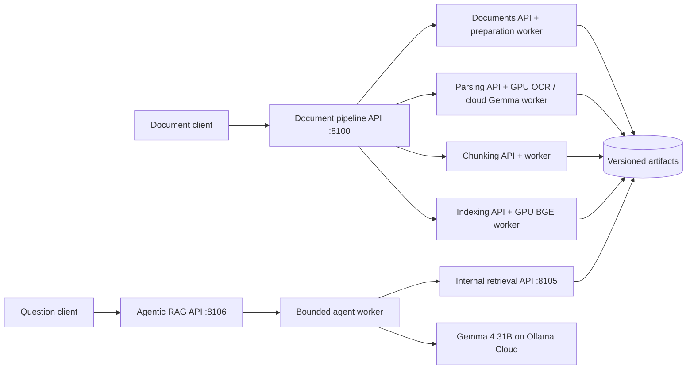

# Document and agentic RAG service boundaries

The document pipeline API and agentic RAG API are separate applications. Uploads
and expensive processing do not run inside the question-answering endpoint.
Each stage has its own API process, OpenAPI contract and durable job queue.
Implementations reuse the installable core package; they are not HTTP calls
between functions inside one API process.



## Responsibilities and APIs

| Service | Local port | Contract |
| --- | --- | --- |
| Document pipeline | 8100 | `POST /v1/documents`, `POST /v1/pipelines`, `GET /v1/pipelines/{id}`; stage routes below |
| Documents/preparation | 8101 | `POST /v1/documents`, `POST /v1/jobs`, `GET /v1/jobs/{id}` |
| Parsing | 8102 | `POST /v1/jobs`, `GET /v1/jobs/{id}` |
| Chunking | 8103 | `POST /v1/jobs`, `GET /v1/jobs/{id}` |
| Indexing/embedding | 8104 | `POST /v1/jobs`, `GET /v1/jobs/{id}` |
| Retrieval | 8105 | `POST /v1/search` |
| Agentic RAG | 8106 | `POST /v1/rag/runs`, `GET /v1/rag/runs/{id}` |

The pipeline exposes individual stages at `/v1/preparation/jobs`,
`/v1/parsing/jobs`, `/v1/chunking/jobs`, and `/v1/indexing/jobs`, with matching
status routes. Internal APIs stay unpublished in Compose. Both public APIs have
`/docs` and `/openapi.json`. Each service has `/health/live` and `/health/ready`.
Readiness checks API storage, not availability of every model or worker.

Bearer authentication protects data and job endpoints. OpenAPI supports its
Authorize control. Credentials are server configuration, not request fields.
Artifact IDs are validated UUID hex strings; clients cannot submit filesystem
paths. Completed artifacts are published after processing succeeds. The owner
can import saved parser runs through a local CLI, avoiding another OCR run.

## Durable processing

Long stages return 202 and a job ID. `Idempotency-Key` reuses a matching job;
reusing it for different input returns 409. Each stage owns a SQLite WAL job
database. A worker atomically claims one job and renews a heartbeat. Expired
running jobs become interrupted when a worker next checks the queue, with no
automatic costly inference retry. Failures and partial artifacts are retained.
The pipeline worker records upstream stage job IDs and waits for each completed
artifact before scheduling the next stage.

This is a single-host deployment using a shared artifact volume and GPU file
lease. It is not a distributed storage/queue implementation. Multi-host scaling
would replace those adapters with object storage, a database/broker and a GPU
scheduler; it should not pretend a local file lock coordinates separate hosts.

## Parsing and chunking

PDFs are rendered through the existing preparation pipeline. DOCX is converted
to PDF by LibreOffice in the documents worker, so page regions refer to a real
rendering rather than invented DOCX coordinates. The original upload and its
hash remain separate. Pagination depends on installed fonts. Legacy `.doc`,
encrypted documents and external DOCX image relationships are unsupported.
DOCX conversion requires the documents image or a host LibreOffice installation.

The parsing worker defaults to quantized dots.mocr (Q4_K_M language + Q8_0 projector).
The parsing image manages a CUDA 12.6 server within each GPU job lease and releases
it afterward. Native development may configure an external DOTS_SERVICE_URL.
PaddleOCR remains available through its separate optional native environment.

Chunking creates `parents.jsonl`, `children.jsonl`, `chunk_manifest.json`,
`validation.json` and `review.html`. Logical continued tables share a parent,
while column groups remain separate children. Repeated headers, captions and
notes are contextual evidence, not new extracted content. Characters of oversized
body parts are preserved through offset slices. Page headers/footers and empty
text are explicitly listed as exclusions. Generated descriptions and inferred
header roles retain their provenance and quality warnings.

Default child targets/maxima are 350/500 **cl100k_base** tokens. The 1,800-token
parent setting bounds grouping of separate narrative elements; an indivisible
large source element or logical table can have a larger stored parent. Retrieval
never blindly returns that entire parent. These settings are initial values,
not an evaluated optimum.

## GPU embedding and retrieval

The configured embedding model is **BAAI/bge-large-en-v1.5**, **1,024 dimensions**,
normalized CLS pooling. The ONNX export comes from
`Qdrant/bge-large-en-v1.5-onnx`; its resolved revision and artifact hashes are
recorded. CUDA is required and an actual ONNX execution profile must contain
CUDA nodes. CPU shape/control operations can still appear in that profile.
Embedding batch size defaults to two for the 6 GB laptop GPU. Service workers
serialize GPU work and release model sessions after use.

BGE has a separate 512-token WordPiece input limit. A child's search text is
split into lossless, offset-addressed windows of at most 480 BGE tokens. All
windows are embedded: there is no silent tail truncation. Retrieval scores a
child by its best window similarity and checks model/revision/dimension
compatibility. Indexes contain SQLite FTS5 BM25, NumPy vectors, window offsets,
parent/child records, source bundle references and checksums.

Hybrid search combines keyword and dense ranks using equal-weight reciprocal
rank fusion. The implementation performs rank fusion, not a trained reranker.
Parent expansion deduplicates matched children, attaches applicable table
headers/notes, and includes complete text/visual parents when they fit. Context
is budgeted after formatting; omitted context is disclosed. Exact matched child
IDs, evidence slices, page regions and provenance remain available for citations.
Keyword-only and no-expansion modes support controlled comparisons.

## Agentic query flow

The RAG worker first retrieves evidence, then asks cloud Gemma to answer, rewrite
the search once, or abstain. At most two retrieval calls are allowed. The worker
generates an answer from the resulting bounded evidence and rejects unknown or
missing citation IDs. Insufficient evidence produces an explicit abstention.
The agent cannot execute code, browse arbitrary URLs or open user-supplied server
paths. Source document text is treated as untrusted data in its system prompt.

Requests, decisions, retrieved evidence and native model responses are retained
in an answer artifact. Citation ID validation establishes referential integrity,
not whether the answer is entailed by the evidence. Answer quality, abstention
and prompt-injection resistance still need independent evaluation.

## Run locally

```bash
uv sync --locked --extra api --extra chunking --extra rag --group browser
uv run --extra api --extra rag python scripts/service_management/configure_service_secrets.py
uv run --extra api --extra rag python scripts/service_management/run_development_services.py
# Stop only these project processes:
uv run --extra api --extra rag python scripts/service_management/run_development_services.py --stop
```

The script starts independent APIs/workers using the existing project environment.
API docs: `http://127.0.0.1:8100/docs` and `http://127.0.0.1:8106/docs`.
Use the locally configured `PIPELINE_API_KEY` as a bearer token. Do not paste it
into documentation, source control or public screenshots.

```bash
# Import an existing reviewed parser run without OCR:
uv run --extra api --extra rag document-pipeline-service import-run \
  outputs/parser_runs/irena-final-source-checked-03

# A standalone chunk preview:
uv run --extra chunking document-parser chunk \
  outputs/parser_runs/irena-final-source-checked-03 \
  --output-directory outputs/rag_bundles/irena-example
```

## Containers

`compose.yaml` separates APIs, CPU workers, GPU workers and the DOCX converter.
Only the pipeline and RAG API ports are published, bound to localhost by default.
The GPU images require NVIDIA Container Toolkit and a supported host driver.
Model downloads go to a cache volume; source PDFs, `.env`, environments and local
outputs are excluded from image contexts. Service keys are mounted as secrets.

```bash
docker compose build
docker compose up -d
docker compose ps
```

The primary parsing image has passed local API/auth, DOCX conversion, page
rendering and GPU CUDA smoke checks, and is public on Docker Hub. Hosted container
validation is tracked separately. This does not establish that the entire
secondary RAG Compose stack has been deployed or evaluated in containers.
See the [API README](../api/README.md), [Docker README](../docker/README.md) and
[CI/CD README](../ci-cd/README.md) for current installation and validation status.
