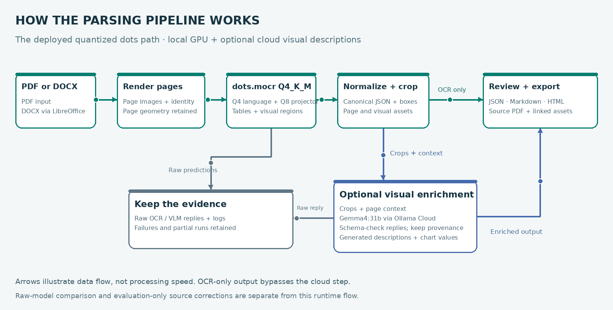

# Multimodal Document Parser

**Turn PDF and DOCX files into source-linked JSON, Markdown and HTML review reports.**
The GPU parsing pipeline combines PaddleOCR-VL-1.6 with optional chart/image
interpretation through Gemma on Ollama Cloud.

[](https://bmaged23.github.io/multimodal-document-parser/?v=2.0)

[Source and evaluation](https://github.com/bmaged23/multimodal-document-parser) ·
[Complete Docker setup](https://github.com/bmaged23/multimodal-document-parser/blob/main/docs/docker/README.md) ·
[API guide](https://github.com/bmaged23/multimodal-document-parser/blob/main/docs/api/README.md) ·
[Release and checksums](https://github.com/bmaged23/multimodal-document-parser/releases/tag/v0.1.0-rc.2)

## What this image does



1. Prepare PDF pages, or convert DOCX to PDF using bundled LibreOffice.
2. Run PaddleOCR on a compatible NVIDIA GPU to extract text, layout, tables and visual regions.
3. Normalize supported output into canonical document JSON with source coordinates and visual crops.
4. Optionally send visual crops and page context to Ollama Cloud for generated descriptions and chart values.
5. Export JSON, Markdown and HTML with linked source pages, assets, provenance and visible warnings.

OCR-only processing bypasses the cloud step. Raw predictions, model replies and
failure diagnostics remain available. Descriptions and inferred structure are
not silently presented as verified source facts.

## Pull the public image

```bash
docker pull bmaged23/multimodal-document-parser:0.1.0-rc.2
```

**Platform:** Linux amd64. Live OCR requires a compatible NVIDIA GPU and host
container GPU support. Development used an NVIDIA GeForce GTX 1660 Ti with 6 GB
VRAM. OCR weights download to a persistent cache on first use.

Docker Hub distributes the image; it does not host a running parsing API. The
interactive demo above displays saved outputs and needs no GPU, account or key.

## Start the APIs and workers

Clone the source to obtain the supported Compose configuration:

```bash
git clone https://github.com/bmaged23/multimodal-document-parser.git
cd multimodal-document-parser
export PARSER_IMAGE=bmaged23/multimodal-document-parser:0.1.0-rc.2
```

Create the local secret files using the **secret setup step in the
[Docker README](https://github.com/bmaged23/multimodal-document-parser/blob/main/docs/docker/README.md#clone-and-run-the-published-image)**.
It generates the service key and optionally accepts an Ollama key without printing
or replacing existing values. Then start the stack:

```bash
docker compose -f compose.parsing.yaml pull
docker compose -f compose.parsing.yaml up -d
docker compose -f compose.parsing.yaml ps
```

One image runs four independently started containers:

| Container | Responsibility |
| --- | --- |
| `documents-api` | Upload PDF/DOCX inputs and queue preparation jobs |
| `documents-worker` | Convert DOCX, render pages and publish prepared artifacts |
| `parsing-api` | Queue parsing jobs, report status and serve output artifacts |
| `parsing-worker` | GPU OCR and optional cloud visual enrichment |

APIs bind localhost by default. Only the parsing worker reserves a GPU; shared
named volumes retain document artifacts and model caches. The image runs as a
non-root user with a read-only application filesystem in Compose.

## API entry points

| Service | Address | Main routes |
| --- | --- | --- |
| Preparation | `http://127.0.0.1:8101/docs` | `POST /v1/documents`, `POST /v1/jobs`, `GET /v1/jobs/{id}` |
| Parsing | `http://127.0.0.1:8102/docs` | `POST /v1/jobs`, `GET /v1/jobs/{id}` |
| Artifact download | On the producing service | `GET /v1/artifacts/{id}` and `GET /v1/artifacts/{id}/files/{filename}` |

Use the local `PIPELINE_API_KEY` as a bearer token for data and job routes.
Long-running jobs return an ID for polling. Readiness checks confirm API/storage
availability, not that every model has already loaded. The
[API guide](https://github.com/bmaged23/multimodal-document-parser/blob/main/docs/api/README.md)
includes an upload → prepare → parse → download example.

## Optional cloud visual descriptions

Use `enrich_visuals: false` for OCR-only parsing. For chart/image descriptions,
provide an Ollama Cloud key with model access and set `enrich_visuals: true`.
The configured model is `gemma4:31b`. It executes remotely; Gemma weights and an
Ollama server are not inside this image. Visual enrichment sends document image
crops and context to the cloud provider. Credentials belong in runtime secrets,
not image layers or build arguments.

## Scope and evaluation

The repository evaluates **PaddleOCR-VL-1.6, quantized dots.mocr and experimental
Unlimited-OCR 2**. This deployment image packages the **PaddleOCR parsing path**.
The separate dots server uses Q4_K_M (4-bit) language weights and a Q8_0 (8-bit)
vision projector; neither its server nor weights are bundled here. Unlimited-OCR
2 remains a diagnostic evaluation path. The optional full chunking/RAG stack is
configured separately in the repository.

PDF and `.docx` are supported; legacy `.doc` and encrypted documents are not.
Extraction quality varies with layout, handwriting, image resolution and model
limits. Source-reviewed evaluation repairs are disclosed case-specific processing,
not a guarantee that every new document is automatically corrected.

## Release verification

Version `0.1.0-rc.2` passed source/browser CI, hosted image/runtime checks and
anonymous registry verification. It includes SPDX SBOM and SLSA build provenance.
Actual local CUDA tensor validation covers the earlier `0.1.0-rc.1` image; hosted
runners have no GPU. These checks establish software/runtime behavior, not OCR
accuracy. Evaluation PDFs, private outputs, credentials and model weights are not
redistributed in the container.

[CI/CD process](https://github.com/bmaged23/multimodal-document-parser/blob/main/docs/ci-cd/README.md) ·
[Measured parser comparisons](https://github.com/bmaged23/multimodal-document-parser/blob/main/docs/parsing-evaluation/README.md)
