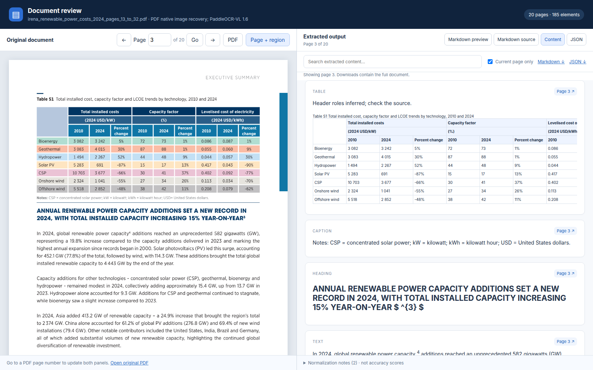
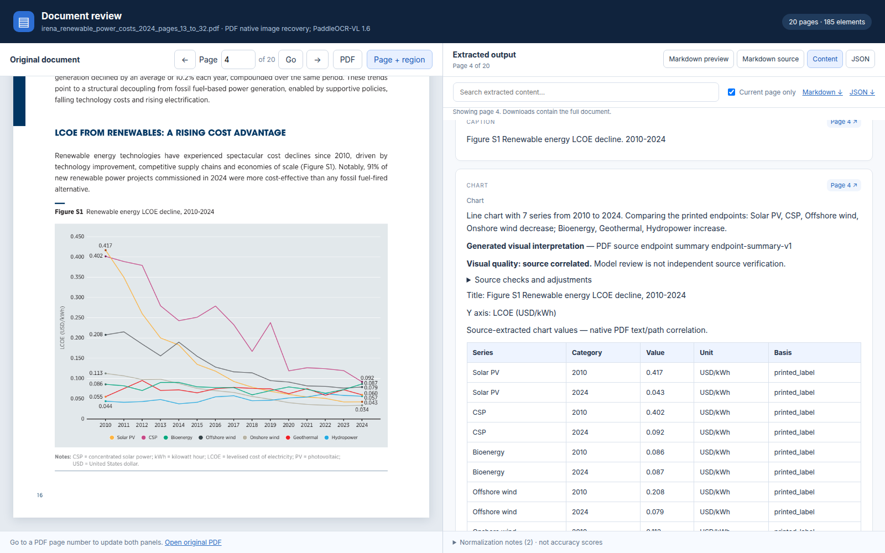

# Parsing evaluation and model comparison

[Project overview](../../README.md) · [Parsing pipeline](../parsing-pipeline/README.md) ·
[Secondary RAG study](../chunking-and-rag/README.md)

This is the project's primary evaluation area: compare parsing models on the
same source material, inspect their errors, and separately measure the final
pipeline after normalization, enrichment and disclosed source corrections.

## Visual evidence



The review places the source at left and extracted content at right. Table
headers marked inferred remain visibly distinguished from extracted content.



These screenshots show source-reviewed final-pipeline output from IRENA PDF
pages 15–16. They are not raw-model accuracy claims.
[Capture details and attribution](../assets/showcase-provenance.json).

## Models and execution scope

**Hardware:** NVIDIA GeForce GTX 1660 Ti, **6 GB VRAM (6,144 MiB)**, Linux/WSL2.
OCR backends ran sequentially; cloud visual-enrichment hardware is separate.

| Configuration | Evaluated path | Interpretation |
| --- | --- | --- |
| PaddleOCR-VL-1.6 | Isolated locked Paddle GPU runtime; canonical JSON/Markdown/HTML | Raw predictions and normalized exports retained |
| dots.mocr Q4_K_M language + Q8_0 projector | Pinned CUDA 12.6/sm75 native runtime on GTX 1660 Ti | Quantized GPU configuration; do not generalize to BF16 or another quantization |
| Unlimited-OCR-2 NF4/FP16 vision experiments | Separately preserved diagnostic runs | Not interchangeable with the common normalized comparison contract |

Retired CPU experiments are historical failure evidence, not active execution
paths. Runtime locks, model identity, quantization, prompts, preprocessing,
generation limits and failure status accompany the saved runs. Details:
[Paddle validation](../evaluation/paddleocr-local-validation.md),
[dots validation](../evaluation/dots-mocr-local-validation.md),
[GPU batch](../evaluation/quantized-gpu-batch.md), and the
[preservation registry](../../evaluation/preserved-runs.json).

## Inputs and references

The corpus includes financial reports, illustrated/scientific material, complex
tables and historical handwritten scans. Downloading a corpus is distinct from
completing inference or scoring every page.

- [Corpus manifest](../../evaluation/corpus-manifest.json): source URLs, hashes,
  page counts, rights notes and initial development selections.
- [Case matrix](../evaluation/evaluation-corpus.md): content diversity and intended checks.
- [Pinned test selections](../../evaluation/test_cases/): original page mappings.
- [Reference annotations](../../evaluation/reference_annotations/): selected
  source-bound assertions; disclose assistant-derived versus independent labels.

Private inputs remain local. Preserve failed attempts and partial subsets;
never describe a completed selection as a completed full source document.

## Measured parser comparison

| Observed case | PaddleOCR-VL-1.6 | Quantized dots.mocr | Unlimited-OCR 2 NF4/FP16 |
| --- | ---: | ---: | ---: |
| NASA selection, 20 pages | 20 accepted | 20 accepted | 20 completed generations |
| NASA median measured page time | 155.7 s | 25.9 s | 108.1 s generation-only |
| Handwritten selection, 5 pages | 5 saved | 3 accepted, 2 token-limit failures | 3 generated, 2 timeouts |
| Selected assertions on one small sensor table | 20/20 | 20/20 | 20/20 |

Unlimited-OCR 2 is a diagnostic raw-output path; its per-page loading is excluded
from the generation timing. It is not an interchangeable canonical backend.
[Third-model configuration and failures](../evaluation/unlimited-ocr-2-gpu-results.md).

Accepted does not mean accurate. Backend preprocessing, inference image size,
initialization and timing scopes differ; these timings are an operational
profile, not a controlled speedup or quality ranking. NASA's selected pages have
no independent accuracy reference. The sensor checks cover one small table.

[Machine-readable profile](../../evaluation/results/parser-comparison-showcase-v1.json)
and [measurement scope](../evaluation/quantized-gpu-batch.md).

## Metrics and what they establish

| Measure | Meaning | Important limit |
| --- | --- | --- |
| Accepted/failed pages | Completion and operational reliability | Completion is not accuracy |
| CER/WER, where references exist | Character/word edit errors against a transcription | Only annotated pages; reading-order convention matters |
| Selected table-cell assertions | Expected text at source row/column positions | Not full table accuracy |
| Span/header assertions | Merged cells and header-role checks | Report inferred structure separately |
| Chart point assertions | Value, series/category and unit association | Separate raw VLM output from source corrections |
| Visual coverage | Expected source regions represented | Detection is not correct interpretation |
| Text agreement | Similarity between model outputs | Models can agree on errors |
| Page timing and sampled GPU memory | Observed runtime/resource use | Scope-specific; device sampling is not allocator peak |

[Scoring contracts and reference format](../evaluation/parser-comparison.md)
explain which metrics the comparison command can produce. Missing references
remain unscored; no accuracy score is invented from agreement or output volume.

## Final-pipeline evaluation is separate

On 46 selected IRENA/IMF pages, selected development checks changed as follows:

| Check | Initial baseline | Source-reviewed final pipeline |
| --- | ---: | ---: |
| Table-cell text | 277/277 | 277/277 |
| Merged-cell span attributes | 40/40 | 40/40 |
| Sampled column-header roles | 0/32 | 32/32, explicitly inferred |
| Printed chart values | 141/144 | 144/144 after PDF source correction |

These are single-assistant development assertions, not an independent benchmark.
The final chart score is not Gemma's raw VLM accuracy. A later raw VLM prompt run
regressed to 135/144; that result remains preserved. Four alternatives in the
five-model VLM comparison lacked account access, so no multi-model quality winner
is claimed.

Read the [initial source review](../evaluation/irena-imf-source-review.md),
[final repairs](../evaluation/final-source-quality-repair.md),
[VLM comparison](../evaluation/five-model-vlm-benchmark.md), and
[selection checkpoint](../evaluation/gemma-selection-checkpoint.md).

## Reproduce and inspect

Run from the repository root using the existing uv environment. Comparing saved
outputs does not require re-running either model:

```bash
uv run document-parser compare outputs/parser_runs/paddleocr-run \
  outputs/parser_runs/dots-mocr-run \
  --output-directory outputs/parser_comparisons/new-comparison
```

The command requires compatible source/preparation settings and publishes
`comparison.json` and `comparison.html`. Serve the output parent directory to
keep linked report assets accessible. Follow the
[comparison guide](../evaluation/parser-comparison.md) to select pages or provide
reference annotations. Use fresh output directories; keep earlier runs intact.

## Preservation and remaining work

Raw responses, source identities, source-page maps, logs, timings, normalized
outputs and checksum inventories are preserved locally by model/configuration.
[Archive policy](../evaluation/preserved-artifacts.md).

Independent human annotations, wider held-out coverage and a live hosted inference
service remain separate work. Source/browser CI, container validation and automated
image publication passed; the public demo displays saved excerpts. RAG scores measure downstream
behavior and must not be used as substitutes for parsing-model accuracy.
