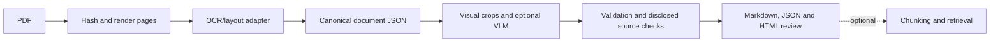
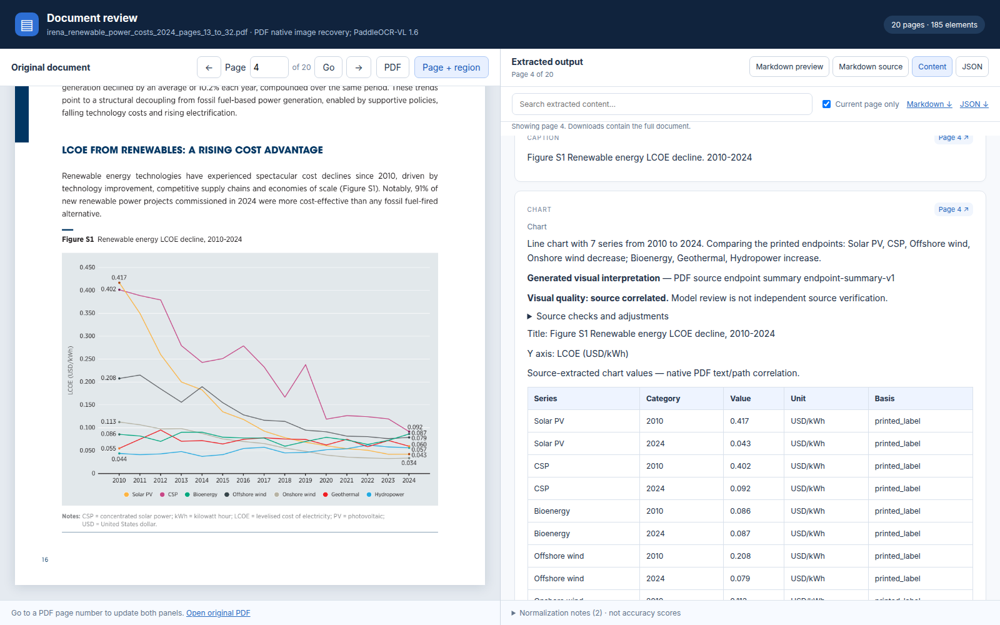

# Parsing pipeline

**Model choice:** dots.mocr is our preferred model family overall on the 70-page test corpus. Original BF16 offers the strongest overall balance; **Q4_K_M language + Q8_0 projector** is the production default for the **GTX 1660 Ti with 6 GB VRAM**. BF16 reached **8.53 GiB peak PyTorch allocation** on Colab T4. [Comparison, measured memory and limits](../evaluation/parser-model-selection.md).

[Project overview](../../README.md) · [Parsing evaluation](../parsing-evaluation/README.md) ·
[Secondary chunking/RAG](../chunking-and-rag/README.md)

The pipeline turns a PDF into source-addressable document data and visual review
reports. Its quality is evaluated separately from each raw parsing model.

Original BF16 dots is the preferred overall quality profile for this test corpus;
quantized dots is the production choice for the smaller 6 GB GPU. Paddle remains
stronger on some table-structure and row-association measurements. See the
[70-page evaluation, ranking and limits](../evaluation/README.md). Formula review
remains necessary.
The deployed service defaults to quantized dots. Its container worker manages the CUDA server; native development can use an external dots endpoint.

## Processing flow



| Stage | Responsibility | Preserved evidence |
| --- | --- | --- |
| Preparation | SHA-256 input identity, page geometry, rendering | Exact PDF snapshot, page images, preparation metadata |
| Parsing | Quantized dots GPU backend by default; optional native Paddle | Raw responses, model/runtime/prompt settings, per-page state |
| Normalization | Reading order, hierarchy, coordinates, table grids/spans | Canonical JSON, normalization notes and original backend data |
| Visual enrichment | Descriptions, chart values/units and flowchart relations | Crops, page context, effective prompts, native responses and provenance |
| Source review | Selected assertions, inferred roles, PDF-based corrections | Separate references, adjustment methods, warnings and before/after scores |
| Export/review | Markdown, JSON, images and interactive HTML | Stable paths, downloads and source-region navigation |

## Document representation

`document.json` uses a versioned Pydantic schema. It retains headings, text,
tables, formulas, chart/image assets and normalized page regions. Tables preserve
cell origins, spans, header annotations and continuation/column-group metadata.
Chart values retain series, category, units and value basis. Extracted, generated,
manual and inferred information remain identifiable.

See the [schema guide](../reference/document-schema.md),
[exported JSON Schema](../../schemas/document-v1.schema.json), and
[processing architecture](../architecture/document-processing-design.md).

Typical artifacts are:

```text
source.pdf                  Exact input selection
document.json               Canonical document and provenance
document.md                 Readable Markdown export
review.html                 Source/output review
assets/pages/               Rendered source pages
assets/crops/               Source-linked visual crops
raw/                        Saved backend responses, where supplied by the stage
run-status.json             Completion/partial/failure state
```

Enriched or source-reviewed runs add their own manifests and adjustment notes.
Use a new output directory rather than overwrite raw predictions or a baseline.

## Local use

Run these commands from the repository root. The project uses uv and Python 3.12;
the heavyweight Paddle runtime is isolated in its own locked environment.

```bash
uv sync --locked
uv run document-parser-check-environment
uv run document-parser prepare data/input_documents/example.pdf --dpi 144
uv sync --project backends/paddleocr_runtime --locked
uv run document-parser parse outputs/parsed_documents/<document-hash>-dpi-144
```

The parse command prints the review location. For dots, configure the retained
quantized GPU server according to its
[runtime README](../../backends/dots_mocr_runtime/README.md); the retired BF16 CPU
experiment is not an active backend.

[Detailed parsing/import commands](../development/paddleocr-parsing-and-html-review.md)
cover existing raw results, page selections, runtime requirements and failure
behavior. Do not re-run long inference merely to inspect an existing report.

## Visual understanding

The current enrichment default is **Gemma 4 31B** (`gemma4:31b`) through Ollama
Cloud. OCR remains in the chosen parser runtime. Configure `OLLAMA_API_KEY` in
the ignored `.env` or environment; credentials are not report data.

```bash
uv run document-parser enrich outputs/parser_runs/my-ocr-run \
  --output-directory outputs/parser_runs/my-enriched-run
```

Generated visual descriptions are not source truth. Exact source values are
distinguished from estimates and from native-PDF corrections. Malformed or
truncated responses remain failed attempts rather than silently repaired text.
[Transport/setup](../development/ollama-visual-enrichment.md),
[initial Gemma checks](../evaluation/gemma4-cloud-visual-validation.md), and
[final source repairs](../evaluation/final-source-quality-repair.md) document the
scope and remaining visual errors.

## Visual review

The HTML report provides source PDF/rendered-page views on the left and Markdown
preview/source, structured content and JSON on the right. Page navigation is
synchronized; search and source boxes connect predictions to their location.
Downloads contain the complete available extraction, with partial runs identified.
Model text is escaped and Markdown sanitized.



[Screenshot source details](../assets/showcase-provenance.json).
Formulas currently display extracted LaTeX rather than full mathematical layout
reconstruction. Read the specific run's warnings before treating a preview as
verified extraction.

## API and processing boundaries

The public document pipeline API is separate from the agentic RAG API. Preparation
and parsing have their own API/worker processes and durable jobs. Long requests
return job IDs; artifact IDs connect stages. Idempotency, heartbeats, interrupted
jobs and a single-host GPU lease protect saved work. Stage readiness does not
guarantee model availability.

| Service | Default port | Relevant routes |
| --- | ---: | --- |
| Public document pipeline | 8100 | `/v1/documents`, `/v1/pipelines`, individual stage job routes |
| Preparation | 8101 | `/v1/documents`, `/v1/jobs` |
| Parsing | 8102 | `/v1/jobs` |

See the [full API/service guide](../architecture/service-pipeline.md) for contracts,
authentication, startup, status routes, storage and worker behavior. Conversion of
DOCX uses a real LibreOffice PDF rendering path but remains unverified on this host.

## Verification and deployment status

The package has local schema, import/export, worker/API and browser checks.
[Evaluation results](../parsing-evaluation/README.md) measure selected source
assertions separately from software correctness. GitHub Actions and Docker
definitions are provided, but hosted execution/container deployment have not been
verified here. The system currently uses single-host filesystem artifacts and
SQLite queues, not a demonstrated distributed production deployment.

Private PDFs, credentials, models and full generated artifacts stay outside Git
and image/package contexts. The [preservation policy](../evaluation/preserved-artifacts.md)
describes immutable local snapshots and failure retention.

## Review and deployment

Use the [expanded results explorer](../development/evaluation-showcase.md) to inspect
saved source/output pairs. The [GPU image and Docker Hub release guide](../deployment/docker-hub.md)
describes PDF/DOCX preparation, OCR, cloud visual enrichment, secrets and CI/CD.
